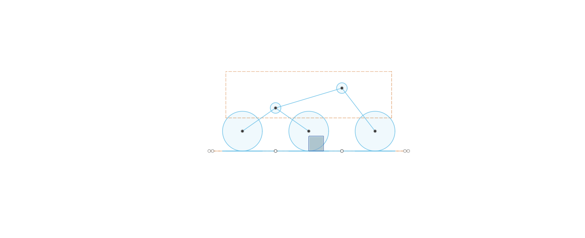
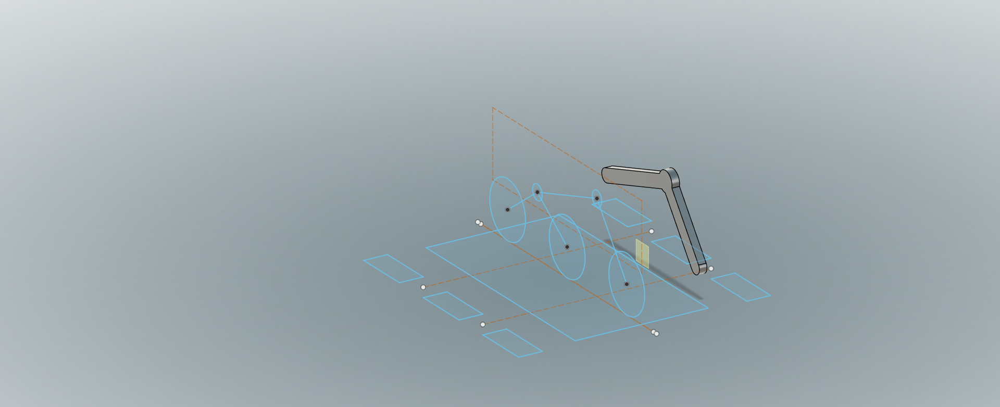
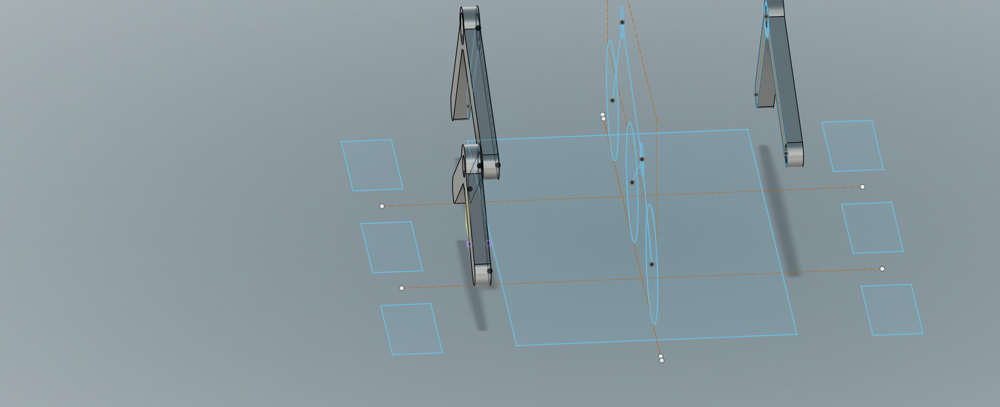
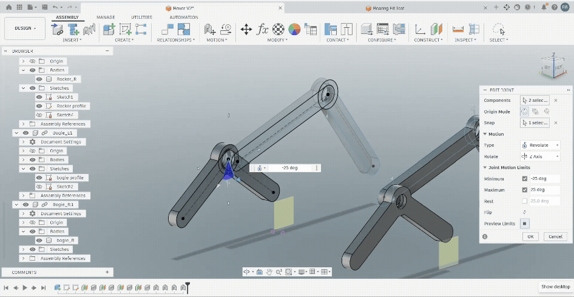
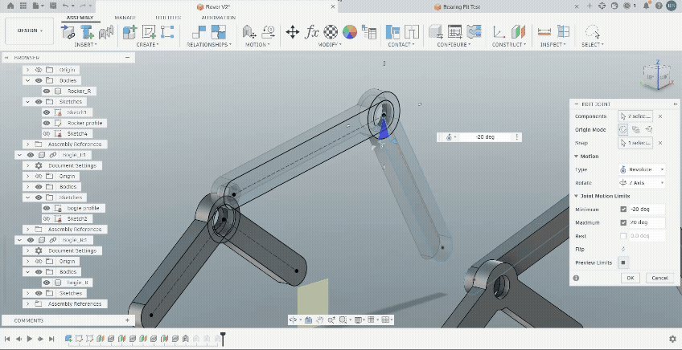
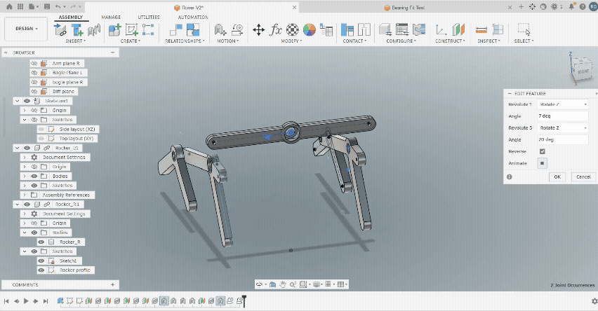

# Build log

Dated screenshots and notes, one entry per milestone.

## 2026-11-11 - Skeleton layout

Parametric skeleton generated by the RoverSkeleton script: 60 mm wheels, 100 mm axle pitch, rocker pivot 95 mm above ground.

## 2026-11-11 - Left rocker modelled

First suspension part modelled in Fusion as a separate Part design inside the Rover V2 assembly. The rocker profile is fully parametric: its three key points (front axle, rocker pivot, bogie pivot) are positioned by user-parameter expressions rather than projected from the skeleton, so the layout can be regenerated without breaking the part.

- Profile: two 14 mm centre-to-centre slots with a 22 mm boss at the rocker pivot, sized to fit a 625ZZ bearing with 3 mm wall
- Extruded 8 mm outward from a work plane offset `body_w/2 + arm_gap` (72 mm) from the centreline
- Rocker pivot sits 95 mm above ground; front axle at +100 mm, bogie pivot at -50 mm

Lesson learned: Fusion's newer design types separate Part and Assembly designs. Assembly designs have no modelling tools, so each part needs to be converted to a Part design before it can be extruded.

Next: stepped bearing seat at the rocker pivot, M5 clearance hole at the bogie pivot, N20 motor clamp at the front axle.

## 2026-11-13 - Both rockers complete

## 2026-11-16 - Bogie_L and pivot nut traps

Modelled Bogie_L outboard of Rocker_L, carrying the middle and rear wheels. Its pivot holds a 625ZZ bearing with the seat facing the rocker.

- Found that a nut on the rocker side of the bogie pivot would hit the body (only a 2 mm gap), so each rocker now has an M5 hex nut trap (8.3 mm AF x 5 mm deep) on its body-side face. The pivot is a single M5 x 16 mm bolt fitted from outside the bogie, so no 30 mm bolts are needed.
- Pivot hole and nut trap were initially placed at the front axle (A) instead of the bogie pivot (C) on both rockers. Caught during an alignment check in Front view and moved to C.
- Bogie bearing seat, rocker C holes and nut traps now share one axis.

Modelled Rocker_R as a mirrored counterpart to Rocker_L (a true mirror is needed so both bearing seats face the body). Both rockers now have the stepped 625ZZ seat at the rocker pivot and an M5 clearance hole at the bogie pivot.

- Wrote `RockerParams`, a Fusion script that adds the shared rocker/bogie parameters to a new Part design
- Track width set to 275 mm to leave room for N20 motors outboard of the bogie
- Bearing fit test block designed; awaiting printer induction
- Parts ordered: 625ZZ bearings, M5 socket cap kit (see `docs/BOM.md`)

## 2026-11-16 - Suspension joints

Bogie_R modelled, completing all four suspension arms. Added as-built revolute joints at the rocker pivots (to the skeleton, standing in for the chassis) and at the bogie pivots, with rotation limits (rockers ±20°, bogies ±25°). All four pivots articulate on the correct axes.

## 2026-11-17 - Differential bar

Added a top-mounted differential bar (170 mm, 625ZZ centre pivot at 135 mm) and 30 mm lugs on both rockers. Motion links couple the two rocker joints (equal and opposite) and the bar (ratio 30/85 from lug length over bar half-length), so the body stays level as the suspension articulates. Physical link rods with M3 ball links to follow.

