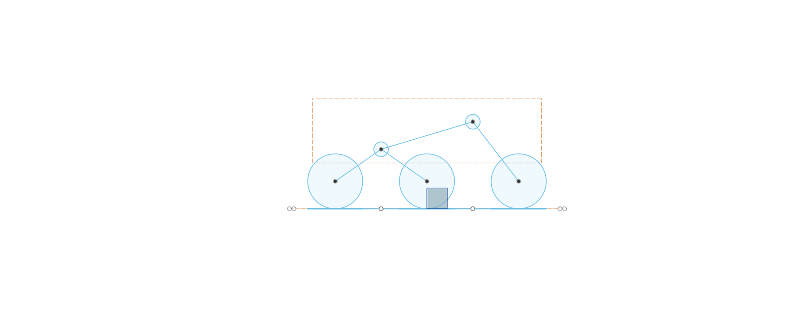

# Build log

Dated screenshots and notes, one entry per milestone.

## 2026-11-11 - Skeleton layout

Parametric skeleton generated by the RoverSkeleton script: 60 mm wheels, 100 mm axle pitch, rocker pivot 95 mm above ground.

## 2026-11-11 - Left rocker modelled

First suspension part modelled in Fusion as a separate Part design inside the Rover V2 assembly. The rocker profile is fully parametric: its three key points (front axle, rocker pivot, bogie pivot) are positioned by user-parameter expressions rather than projected from the skeleton, so the layout can be regenerated without breaking the part.

- Profile: two 14 mm centre-to-centre slots with a 22 mm boss at the rocker pivot, sized to fit a 625ZZ bearing with 3 mm wall
- Extruded 8 mm outward from a work plane offset `body_w/2 + arm_gap` (72 mm) from the centreline
- Rocker pivot sits 95 mm above ground; front axle at +100 mm, bogie pivot at -50 mm

Lesson learned: Fusion's newer design types separate Part and Assembly designs. Assembly designs have no modelling tools, so each part needs to be converted to a Part design before it can be extruded.

Next: stepped bearing seat at the rocker pivot, M5 clearance hole at the bogie pivot, N20 motor clamp at the front axle.

